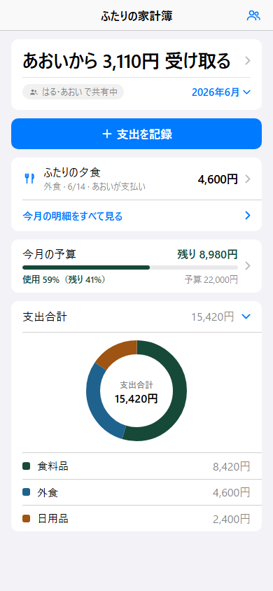
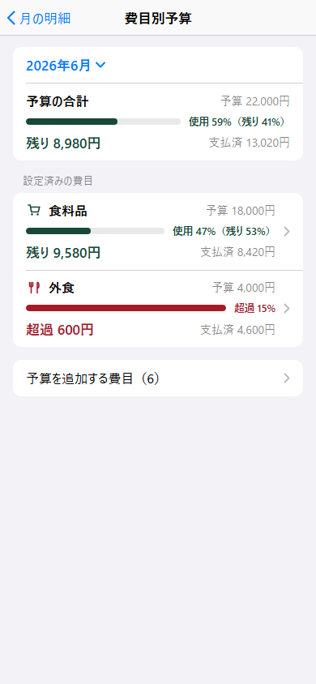
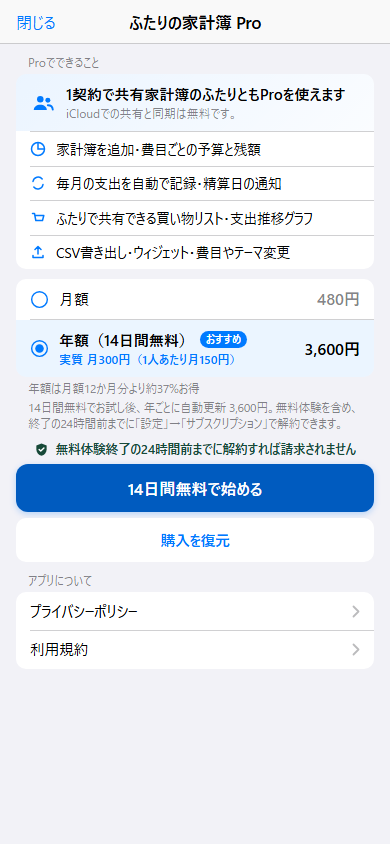

# ふたりの家計簿・第7回独立批評（390px プレビュー実視認 × 競合比較）

**総合評価: 60 / 100（7軸合計 42 / 70・平均 6.0 / 10，推移: r5 `57` → r6 `63` → r7 `60`）**  
**停滞判定: 厳密には r5→r6 で +6、r6→r7 で -3 と変動しているが、3ラウンド通算で 60 点前後（+3点）の踊り場にあり、競合トップ帯（シェアルー: ★4.5・15,240件・月¥600／年¥3,600／買い切り¥9,800）と売れる水準には未達。**

---

## 0. 批評時点のプレビュー再生成と実画像確認の証跡

- 再生成コマンド: `node tools/preview/render.mjs *> tmp/render-r7.log`（終了コード `0`、`--headless=new --disable-gpu --disable-background-networking`、ローカル HTML 描画・外部通信なし）
- ログ: `tmp/render-r7.log`
- 批評者による画像開封: 下記 3 枚の 390×844 PNG をすべて直接開いて視認し、`inspect_images` でも寸法・SHA-256・平均輝度を検証した。なおこれらは静的 HTML（`tools/preview/*.html`）の Chromium 近似描画であり、iOS 実機 SwiftUI 描画ではないため、**見た目・余白・折返し・視認性・競合画面との視覚比較に関する判定はすべて「推測」を付す。**

| 画面 | PNG パス | 寸法 | サイズ | SHA-256 | 平均輝度 (Rec.709) |
| --- | --- | --- | ---: | --- | ---: |
| ホーム | `docs/preview/home-390.png` | 390×844 | 24,061 B | `e9c6eb007a170c761b1de674fb47d3061cdf77ba397dc6bd74b06f1f4840fa23` | 236.21 |
| 予算 | `docs/preview/budget-390.png` | 390×844 | 41,673 B | `906e2dcdeaf929329393156905e9b48ec38e773618c57f097861dbf77a1e7f1e` | 245.07 |
| 課金 (Paywall) | `docs/preview/paywall-390.png` | 390×844 | 66,350 B | `94b054e3db5aeacbc97e2d57d9a625f3a1681044bd011ebc77c26d0e1983391e` | 241.06 |

- 確認済み前提（current tip）: 日本の確定価格（月額 480円・年額 3,600円、14日間無料体験、約37%お得）および「1契約で共有家計簿のふたりともProを使えます」は `FutariKakeibo.storekit`、`Sources/FutariKakeibo/ProPaywall.swift`、`docs/app-store/metadata.ja.json`、`docs/release-checklist.md`、`tools/preview/paywall.html` に反映済み。アプリコードは一切変更していない。

---

## 1. 7軸スコアと推移（r5 → r6 → r7）

| 軸 | r5 | r6 | r7 | 推移 | 今回（390px プレビュー確認後）の根拠 |
| --- | ---: | ---: | ---: | :---: | --- |
| 1. 初回1分（導入〜初回保存・最初の価値・タップ数） | 6 | 7 | **7** | → | `home-390.png` で青い「+ 支出を記録」ボタンが上部に明確に配置され、2操作＋桁数で記録可能（推測）。一方 `CloudLedger.mayCreatePrimary` の iCloud 初回取込待ちブロック（`CloudLedger.swift:131-133`）は未解消。 |
| 2. ホームの明快さ（主数値1つ・不要情報なし） | 6 | 7 | **6** | ↘ | コード読み（r6）では高評価だったが、`home-390.png` 実視認で「あおいから / 3,110円 / 受け取る」が **3行に折返し**、下半分約45%が空白、円グラフも予算残額も未展開で「支出合計」に隠れていることが判明（推測）。 |
| 3. 予算・精算画面（明細・計算・進捗） | 5 | 7 | **6** | ↘ | `budget-390.png` 実視認で、バー塗り幅が **消費率（59% / 47%）** なのに直下の文字列が **「残り割合 40% / 53%」** と逆転している矛盾、超過時の **「残り割合 -15%」** という不自然な日本語、5段積みの過密表示とアイコン不在が露出（推測）。`SettlementReview` の個人別支払・負担内訳も依然欠落。 |
| 4. 課金画面（Paywall：内容・価格・体験・復元・CTA） | 6 | 6 | **5** | ↘ | `paywall-390.png` 実視認で致命的欠陥を確認。**「14日間無料で始める」「購入を復元」が非活性の薄グレー文字**（`--disabled-label`、実コードでも `ProPaywall.swift:59,62` で `products[selection] == nil` 時に `.disabled`）に見え、8行の長い機能リストに押されて「アプリについて」が 844px 下端で見切れている（推測）。 |
| 5. 2〜7日目の継続理由（ウィジェット・通知・招待） | 4 | 4 | **5** | ↗ | r6後の反映（`WidgetPublishing.swift:16` の無料精算額表示、`LedgerWidget.swift:62` の `widgetURL`、`BookSettings.swift:169` の通知時刻 `DatePicker`、`FutariKakeiboApp.swift:145-152` のホーム招待導線）で +1。ただし `.systemSmall` のみ・通知が `person.2` 奥・招待の Apple Account メール必須の壁が残る。 |
| 6. ストア公開準備（掲載文・スクショ・設定） | 6 | 6 | **6** | → | 確定価格・2人共用コピーの整合は取れているが、ストア画像見出し原稿（`screenshots.ja.md`）、`AppIcon` の `project.yml` 組込、本番 Bundle ID / CloudKit / 法務・サポート URL、実機 Xcode ビルド＆XCUITest 撮影が未完了。 |
| 7. アクセシビリティ（文字拡大・VoiceOver・配色） | 7 | 7 | **7** | → | `budgetTone` の高コントラストと `Home.settlementHeader`・`YenRow` の `isAccessibilitySize` 縦積みは堅実。ただし `ProLock` の鍵状態読み上げ欠如、`MonthDetail`/`SpendingCharts` 月送り `HStack`、`.teal` テーマ白文字コントラスト懸念、`paywall-390.png` における薄グレー CTA の低コントラスト（推測）が未修正。 |
| **総合スコア** | **57** | **63** | **60** | ↗↘ | 7軸合計 **42 / 70（平均 6.0 / 10）**。機能追加（r5→r6）で基礎点は上がったが、390px 実視認で画面構造・CVR導線の弱さが露呈し -3。 |

### 停滞（Stalled Score）判定とアプローチ変更の提案

- **判定**: スコア推移は **57 (r5) → 63 (r6) → 60 (r7)** であり、数値上は3連続完全停止ではないものの、**3ラウンドを通じた純増はわずか +3 点（60点台前半で停滞）**。シェアルー等のトップ帯アプリ（推測 80点超）との差は縮まっていない。
- **詰まっている根本原因**: これまでの改善は「既存の縦1列 `List` の中にテキスト行や `DisclosureGroup` を足す」パッチ型に留まっており、**画面階層の深さ（ホーム → 月の明細 → 費目別予算が3階層）**、**Paywall の購入転換設計（リスト形式のまま）**、および **Windows 上の HTML 近似＋正規表現テスト依存で実機 UI を確認できない検証ループ** が天井を作っている。
- **提案するアプローチ変更**:
  1. **第1階層ナビゲーションへの再編**: 1本の `List` へ情報を押し込むのをやめ、競合（シェアルー）同様にホーム直下に **`グラフ / 予算`（または `精算・記録 / 予算 / 設定`）の第1階層タブ** を設けて、主要価値を1タップ以内で見せる。
  2. **変換（CVR）主導の Paywall 再設計**: `Form`/`List` の設定画面風レイアウトを捨て、「ヒーロー見出し＋4ベネフィット＋年額おすすめカード（実質月300円）＋塗りつぶし活性 CTA」を 390×844 のファーストビューに収める専用レイアウトへ切り替える。
  3. **視覚検証ループの実機化**: HTML 近似プレビューの更新をアプリ本体と同期させつつ、CI（Xcode / `FutariScreenshots`）で実 SwiftUI レンダリング画像を回す体制を最優先で通す。

---

## 2. 画面別の修正可能なギャップ一覧（各5件以上）

競合アプリ：**シェアルー**（★4.5・15,240件、月¥600・年¥3,600・買い切り¥9,800。ヘッダー `2026年1月` ドロップダウン、`グラフ / 予算` タブ、月次予算リストにアイコン・割合付き横バー・`今月 40,000円`・赤字の `超過`／`残り`・`支払済`、先頭 `合計` 行 `17%, 残り 37,756円`、`過去の予算残額を繰り越す` トグル、コピー「みんなの支出をグラフで可視化」、オレンジ基調の視覚強調）。

### (A) ホーム画面（`docs/preview/home-390.png` / `tools/preview/home.html` / `Sources/FutariKakeibo/FutariKakeiboApp.swift`）

1. **精算ヒーロー文言の3行折返しと視覚バランス崩れ**（`推測`）
   - **該当要素**: `.settlement-row` 内の `.settlement-title`（「あおいから / 3,110円 / 受け取る」が3行に折返し）と右横の `.month-menu`（`2026年6月 v`）（`home.html:179-192`、`FutariKakeiboApp.swift:235-274`）。
   - **競合の実装**: 月ヘッダー `2026年1月 v` を最上段に独立配置し、その下の主コンテンツ領域を全幅で使って視線を止めない（`推測`）。
   - **具体的な変更**: 月選択 `Menu`（`2026年6月 v`）をヒーローカード上段の独立行またはナビゲーションバー直下へ分離し、精算額カードは全幅で「あおいから受け取る」（小見出し）＋「**3,110円**」（1行・`.largeTitle`）に整理する。
2. **画面下半分（約45%）の空白と支出グラフの折りたたみ隠蔽**（`推測`）
   - **該当要素**: `支出合計 15,420円 >` 行（`home.html:214-222`）および閉じた `DisclosureGroup` 内の `HomeSpending` / `SectorMark`（`FutariKakeiboApp.swift:292-369`）。`home-390.png` では y=430〜844px が完全に無地のグレー背景。
   - **競合の実装**: 「みんなの支出をグラフで可視化」を前面に出し、`グラフ / 予算` タブで初回表示からグラフと費目内訳を見せる。
   - **具体的な変更**: `HomeSpending` をデフォルト展開（または第1階層 `グラフ` タブ化）にし、ホームを開いた状態でドーナツグラフ（中央に `支出合計 15,420円`）と色見本付き費目内訳を常時表示する。
3. **予算残額サマリの第1画面不在（ホーム390px プレビューでゼロ表示）**（`推測`）
   - **該当要素**: `home-390.png` 全体（`home.html` に予算ブロックがなく、`FutariKakeiboApp.swift:170-185` でも Pro かつ予算設定済み時のみ末尾に簡素な1行 `今月の予算` が出る構造）。
   - **競合の実装**: 第1階層の `グラフ / 予算` タブで「今月の予算残り・超過」へ1タップ遷移できる。
   - **具体的な変更**: 上部に `精算・グラフ / 予算` の切り替えタブを置くか、ホームの支出カード直下に「今月の予算 残り 8,980円（40%）」のプログレスバー付きミニカードを常設し（未設定・無料時も案内導線を表示）、1タップで予算管理へ入れるようにする。
4. **直近支出行の金額左寄せ不整合と費目・日付の欠落**（`推測`）
   - **該当要素**: `.expense-stack`（`ふたりの夕食` / `あおいが支払い` / `4,600円` が3行すべて左寄せ、`home.html:203-212`、`FutariKakeiboApp.swift:158-163`）。すぐ下の `支出合計 15,420円` は金額が右寄せで列が揃っていない。
   - **競合の実装**: 支出・予算行ともアイコン＋タイトル（左）と金額（右）の整った横並びリストを採用（`推測`）。
   - **具体的な変更**: 直近支出行を `HStack` に改め、左に「費目アイコン＋`ふたりの夕食`＋サブ行 `外食 · 6/14 · あおいが支払い`」、右に太字 `4,600円` を配置して下の `支出合計` と右端金額を揃える。
5. **ふたり利用・共有状態の可視化不足（右上アイコン1つのみ）**（`推測`）
   - **該当要素**: ナビバー右上の `.nav-trailing`（`person.2` 線画アイコンのみ、`home.html:167-174`、`FutariKakeiboApp.swift:192-199`）。
   - **競合の実装**: 共有家計簿としてのメンバー文脈を画面上で意識させ、「みんなで使う」安心感を保つ（`推測`）。
   - **具体的な変更**: 精算カード上部またはヘッダー直下に「はる・あおい で共有中」（未招待なら「パートナーを招待して同期 >」）のコンパクトな状態ピルを表示する。
6. **「月の明細」への遷移が精算カードの薄い `>` に隠れている**（`推測`）
   - **該当要素**: `.settlement-link` 右側の薄いグレー `>`（`home.html:182-184`、`FutariKakeiboApp.swift:240-256`）。
   - **競合の実装**: 明細・グラフ・予算へ迷わず行ける明示的なナビゲーションを備える。
   - **具体的な変更**: 直近支出カードの末尾に「今月の明細をすべて見る >」行を追加し、精算カードをタップしなくても一覧・過去月明細へ入れる導線を明示する。

### (B) 予算画面（`docs/preview/budget-390.png` / `tools/preview/budget.html` / `Sources/FutariKakeibo/ProSettings.swift`）

1. **プログレスバーの塗り幅（使用率）と下段ラベル（「残り割合」）の意味逆転・超過時の「残り割合 -15%」**（`推測`）
   - **該当要素**: `BudgetProgressRow` の `.progress-fill`（幅 `59.18%` / `46.78%`、`budget.html:169,183`、`ProSettings.swift:156`）と直下の `.footnote`（`残り割合 40%` / `残り割合 53%` / `残り割合 -15%`、`budget.html:170,184,201`、`ProSettings.swift:159`、`Ledger.swift:158-159`）。
   - **競合の実装**: `合計 17% 残り 37,756円`、`食費 -103% 超過 41,098円 | 支払済 81,098円` と表示し、バーの割合感覚と数値表記が一致し、超過時は「残り」とは言わない。
   - **具体的な変更**: ①バーの塗り幅と数値の基準を統一する（例：消費率ベースならバー59%＋「使用 59%（残り 40%）」、または残額バー40%＋「残り 40%」）、②超過時は「残り割合 -15%」をやめて「**超過 15%（-15%）**」へ書き換える。
2. **1費目5段積みの縦肥大による一覧性低下**（`推測`）
   - **該当要素**: `BudgetProgressRow`（`予算の合計`・`食料品`・`外食` がそれぞれ `費目+予算` / `支払済` / `残り・超過` / `4pxバー` / `残り割合` の5段、`budget.html:161-206`、`ProSettings.swift:147-164`）。設定済み2費目＋未設定6費目で 844px 全高を使い切っている。
   - **競合の実装**: 各費目を2〜3行（アイコン・費目・予算／パーセント付き横バー／残り・超過｜支払済）に凝縮し、多くの費目を1画面で比較できる。
   - **具体的な変更**: 1行目「アイコン＋費目名 | 予算 18,000円」、2行目「太さ8px横バー＋右端に `残り53%`（超過時は赤で `-15%`）」、3行目「`残り 9,580円`（太字・色分け）| `支払済 8,420円`（右寄せ補助色）」の3段レイアウトへ圧縮する。
3. **費目アイコンの欠如による視認・識別性の弱さ**（`推測`）
   - **該当要素**: `食料品`〜`その他` の全8行が文字のみ（`budget.html:178-250`、`ProSettings.swift:109-118`）。
   - **競合の実装**: 月次予算リストの全費目行に、色付きアイコンを付けてパッと見で食費・外食・日用品を区別できる。
   - **具体的な変更**: 標準8費目とカスタム費目に SF Symbols（`cart.fill`, `fork.knife`, `basket.fill`, `house.fill`, `bolt.fill`, `tram.fill`, `sparkles`, `ellipsis.circle`）の軽量アイコンを左端に追加する。
4. **月表示が静的テキストで予算画面内から月切替・グラフ往復ができない**（`推測`）
   - **該当要素**: `.section-header` の `2026年6月`（タップ不可のグレー見出し、`budget.html:159`、`ProSettings.swift:83`）および3階層目の `< 月の明細` 戻り導線。
   - **競合の実装**: 予算画面最上部に `2026年1月 v` ドロップダウンと `グラフ / 予算` タブを備え、1画面内で月比較とグラフ確認を完結させる。
   - **具体的な変更**: 予算画面上部に月選択ドロップダウン（`2026年6月 v`）を配置し、ホームからの遷移階層も第1階層タブ（`グラフ / 予算`）へ引き上げる。
5. **「過去の予算残額を繰り越す」トグル機能の欠如**（`推測`）
   - **該当要素**: `BudgetSettings` 内（`budget.html:158-255`、`ProSettings.swift:78-123` は前月予算額の1回コピー `copyPreviousBudget` のみ）。
   - **競合の実装**: 「過去の予算残額を繰り越す」トグルを備え、余剰予算の繰り越しによる節約継続を後押ししている。
   - **具体的な変更**: 予算サマリ直下または予算設定ヘッダーに「過去の予算残額を繰り越す」トグルを追加し、設定月で残額繰越を選べるようにする（仕様確定前はオン／オフ切替可能なオプション設計）。
6. **「予算の合計」カードの区別不足と「未設定」6行による下部圧迫**（`推測`）
   - **該当要素**: 同じ白カード最上段の `予算の合計`（シェブロンなし）と下半分を占める `未設定` 6行（`budget.html:161-172,209-254`）。
   - **競合の実装**: `合計` 行を上部サマリとして際立たせ、設定済み費目の進捗を主役に配置する。
   - **具体的な変更**: `予算の合計` を独立した上部サマリカードへ分離し、未設定の費目は折りたたみセクション（「予算を追加する費目（6）」）に畳んで設定済み費目の見通しを良くする。

### (C) 課金画面・Paywall（`docs/preview/paywall-390.png` / `tools/preview/paywall.html` / `Sources/FutariKakeibo/ProPaywall.swift`）

1. **主要CTA「14日間無料で始める」「購入を復元」が非活性の薄グレー文字に見える致命的欠陥**（`推測`）
   - **該当要素**: `.action-primary` (`14日間無料で始める`) と `.action-secondary` (`購入を復元`) の `color: var(--disabled-label)`（`rgba(60,60,67,0.3)`、`paywall.html:111-121,181-185`）、および実コード `ProPaywall.swift:56-62` の `.disabled(busy || products[selection] == nil || !ledger.canPurchasePro)`＋プレーン文字ボタン。
   - **競合の実装**: 最も押してほしい購入 CTA を高コントラストの塗りつぶしボタンとして目立たせる（`推測`）。
   - **具体的な変更**: 主 CTA を `.buttonStyle(.borderedProminent)`（角丸 12px・高さ 50px・白太字・アクセント背景）に変更し、`ScreenshotDemo` や HTML プレビューでも活性カラーで描画、通信読み込み中も押下可能感・視認性を損なわないよう改善する。
2. **8行の長文機能リストが画面上半分を占有し、価格・CTA・法務リンクが844px下端へ押し出され見切れ**（`推測`）
   - **該当要素**: `Proでできること` カード（高さ約 430px、`paywall.html:132-152`、`ProPaywall.swift:20-34`）と 844px 下端で途中切れしている `アプリについて`（`paywall.html:187-204`）。
   - **競合の実装**: ベネフィットを端的に絞って上部にまとめ、プラン選択と CTA をスクロールなしでファーストビューに収める（`推測`）。
   - **具体的な変更**: 8機能をアイコン付き3〜4項目（例：①複数家計簿・カスタム費目、②費目別予算・支出グラフ、③定期入力・買い物リスト、④CSV・ウィジェット・通知）へ2行以内で圧縮し、**ヒーロー＋機能＋プラン＋塗りつぶしCTA＋規約** が 390×844 に余裕で収まるよう再設計する。
3. **年額の割安感・1人あたり単価・買い切り比較のアンカー不足**（`推測`）
   - **該当要素**: `月額 480円` / `年額（14日間無料） 3,600円` 行と13px薄グレー脚注 `年額は月額12か月分より約37%お得`（`paywall.html:154-179`、`ProPaywall.swift:49-51,77-93`）。
   - **競合の実装**: 月¥600・年¥3,600・**買い切り¥9,800** を並べて比較させ、年額や長期割の納得感を高めている。
   - **具体的な変更**: 年額プランカード内に「**おすすめ・37%お得**」ピルバッジと「**実質 月300円（ふたりで1人月150円）**」の太字サブ表記を入れ、将来の買い切りプラン（例：¥9,800帯）追加も視野にプラン比較カード化する。
4. **設定画面と区別がつかないプレーンな視覚階層（ヒーロー不足）**（`推測`）
   - **該当要素**: `ProPaywall` 全体の標準 `List` スタイル（`paywall.html:126-205`、`ProPaywall.swift:19-67`）。
   - **競合の実装**: ブランドカラー背景やアイコン・ビジュアルで「Pro にすると何が良くなるか」を一目で伝える（`推測`）。
   - **具体的な変更**: 画面最上部にコンパクトなヒーローバナー（2人アイコン＋「**1人分で、ふたりともずっと Pro**」＋サブコピー「iCloud共有は基本無料」）を置き、リスト一辺倒の印象を脱する。
5. **無料体験の課金タイミング安心コピーの視認性不足**（`推測`）
   - **該当要素**: 3行にわたる 13px 薄グレー脚注 `14日間無料でお試し後、年ごとに自動更新 3,600円。無料体験を含め...`（`paywall.html:178`、`ProPaywall.swift:122-125`）。
   - **競合の実装**: 体験開始の心理的ハードルを下げる「期間中の解約なら0円」をCTA近くで分かりやすく伝える（`推測`）。
   - **具体的な変更**: 「14日間無料で始める」ボタン直上に「**無料期間中の解約で料金は一切かかりません**」の1行安心表示（濃い文字色＋チェックアイコン）を置き、法的な自動更新細則はその下へ分離する。

---

## 3. CVR（転換率）・2〜7日目継続率インパクト順 トップ8ランキング

| 順位 | 対象画面 / 領域 | 施策内容 | 期待効果（CVR / 2〜7日継続） |
| ---: | --- | --- | --- |
| **1** | **Paywall** | 主CTA「14日間無料で始める」を非活性グレー行から**高コントラスト塗りつぶしボタン**へ変更し、機能一覧を圧縮してファーストビュー（390×844内）にプラン・CTA・安心コピー・法務リンクを収める（`ProPaywall.swift:19-67`, `paywall.html`）。 | **CVR 最大（直接改善）**: 押せるボタンに見えない致命傷とスクロール脱落を解消し、無料体験開始率を引き上げる。 |
| **2** | **Home / Budget** | 深い3階層遷移を改め、第1階層に **`グラフ / 予算` タブ**（またはホーム上の展開済み円グラフ＋予算残額ミニカード）を設け、ホーム下半分の空白45%を解消する（`FutariKakeiboApp.swift:90-186,292-370`）。 | **2〜7日継続 大幅改善**: 「毎日開いて支出割合と残り予算を見る」日常利用ループを作り、予算Proへの導線（CVR）も太くなる。 |
| **3** | **Budget** | プログレスバーの向き（消費率）と「残り割合」ラベルの矛盾を統一し、超過時の「残り割合 -15%」を「超過 15%」へ修正。**費目アイコン追加＋3段コンパクト化**（`ProSettings.swift:104-169`, `Ledger.swift:153-163`, `budget.html`）。 | **2〜7日継続・CVR 改善**: 数字とバーの認知負荷・違和感をなくし、Pro最大の目玉である予算管理の満足度を競合水準へ近づける。 |
| **4** | **Paywall** | 年額行に「**おすすめ・37%お得 / 実質月300円（1人あたり月150円）**」の価格アンカーとヒーロー見出し「1契約でふたりともPro」、CTA直上の「体験中解約で0円」安心1行を追加する（`ProPaywall.swift:20-55,77-97`）。 | **CVR 向上**: 月額480円・年額3,600円（2人共用）という競合より安い実質単価を即座に理解させ、年額体験への転換を高める。 |
| **5** | **Home** | 月選択 `2026年6月 v` を精算額の横から切り離し、「**あおいから受け取る / 3,110円**」の3行折返しを解消。直近支出行も右揃え金額＋費目・日付付きへ整え、「すべての明細を見る」リンクを追加する（`FutariKakeiboApp.swift:153-166,235-274`, `home.html`）。 | **初日〜2日目継続・信頼感**: 第一印象のレイアウト崩れを直し、迷わず明細・過去月に辿り着ける。 |
| **6** | **Home / 共有** | パートナー招待の **Apple Account メール手入力必須**（`BookSettings.swift:232-251`）を緩和する `UICloudSharingController` 等の柔軟な共有シート併設＋ホーム上部の共有ステータスピル表示（`FutariKakeiboApp.swift:145-152`）。 | **2〜7日継続・CVR 両効き**: カップルアプリ最大の離脱点である「2人目の参加完了」を増やし、2人利用定着とPro価値を解放する。 |
| **7** | **初回1分 / 同期** | `CloudLedger.mayCreatePrimary`（`CloudLedger.swift:131-133,479`）の iCloud 初期取込完了待ちを解除し、起動即時にローカル仮記録できて後続取込と安全に統合できるようにする。 | **初日〜2日離脱防止**: 通信遅滞環境でも「初回1分で記録完了」を守り、最初の一歩での離脱を防ぐ。 |
| **8** | **Budget / 継続 / Store** | ①「**過去の予算残額を繰り越す**」トグル追加、②無料ウィジェットから入力への定着計測と通知設定のホーム/初回導線化、③ `docs/app-store/screenshots.ja.md` 新設と `AppIcon`・本番設定確定（`project.yml`）。 | **長期継続・DL CVR**: 2か月目の継続動機（繰越）とインストール前の魅力訴求（ストア画像見出し）を補完する。 |

---

## 4. 未確認・次ラウンドへの検証要件

1. **実 SwiftUI レンダリングと Xcode テスト**: `tools/preview/*.html` は HTML 近似であり、`FutariKakeiboApp.swift:170-185`（Pro時のホーム予算1行）や `HomeSpending` 展開時の円グラフ描画は実機/シミュレータ確認が未完了。CI 上で `xcodebuild` と `FutariScreenshots`（ライト/ダーク・AX最大文字サイズ）を実行する必要がある。
2. **競合比較の範囲**: 競合（シェアルー）の仕様・画面構成は本依頼の Context に記載されたストア観測情報（2026-11-27 時点）に基づく。競合の内部課金遷移詳細や実アプリ操作感は未計測（`推測`）。

---

## 対応

日本の価格は月額480円、年額3,600円。1契約で共有家計簿のふたりが利用でき、対象者は年額を14日間無料で体験できます。

| 順位 | 状態 | 対応内容・理由 |
| ---: | :---: | --- |
| 1 | 直った | 購入を濃い青の全幅ボタン、復元を独立した行に変更。機能を4行に圧縮し、390pxプレビューで価格・体験条件・購入と復元・法務リンクを確認。価格取得前は購入を無効にし、読み込みや再試行を案内する。 |
| 2 | 直った | ホームで支出内訳を初期展開し、その手前に予算サマリと設定導線を置いた。記録のある無料家計簿からは予算機能の案内を開ける。 |
| 3 | 直った | 予算を費目アイコン付きの3段に整理。使用率と残りは丸めをそろえ、超過は「超過 15%」と表示する。大きな文字ではバーと割合、金額を縦に並べる。 |
| 4 | 直った | 共有契約の説明と年額のおすすめ表示を追加。日本の年額は月300円相当、2人で割ると1人あたり月150円相当。換算はストアの通貨で表示し、CTAの上で無料体験の解約期限を案内する。 |
| 5 | 直った | 精算額と月選択を別の段にし、精算文は行数を制限せず折り返す。直近支出に費目と日付を添え、選択月の明細を開く行を追加。大きな文字では支出額を縦に並べる。 |
| 6 | 残った | ホームに共有状態を表示。メール入力を省ける招待シートは、CloudKitの招待と受諾を通した動作確認を伴うため対象外。 |
| 7 | 残った | iCloud初回取込の待機を除くには、先に作った記録を既存帳簿へ統合する設計が必要。 |
| 8 | 残った | 予算残額の繰越は計算ルールの決定が必要。ウィジェットの計測、通知への導線、ストア画像の原稿と本番設定は今回の3画面の範囲外。 |

### 画面別の判定

| 画面 | ギャップ | 状態 | 対応内容・理由 |
| --- | --- | :---: | --- |
| ホーム | A1 精算の折り返し | 直った | 月選択を分離。390pxの例は1行で収まり、大きな文字では全文が複数行に流れる実装。 |
| ホーム | A2 グラフが隠れる | 直った | 円グラフと費目別の金額を初期展開。 |
| ホーム | A3 予算残額が見えない | 直った | 支出グラフの手前に予算残額と管理への導線を配置。 |
| ホーム | A4 直近支出の情報不足 | 直った | 費目と日付、支払者を表示し、標準サイズで金額を右揃え。 |
| ホーム | A5 共有状態が分からない | 直った | 名前と共有状態を精算欄に表示。 |
| ホーム | A6 明細の入口が目立たない | 直った | 選択月の明細を開く行を追加。 |
| 予算 | B1 バーと割合が不一致 | 直った | 例では使用59%・残り41%。超過行は超過率で表示。 |
| 予算 | B2 費目行が長い | 直った | 標準の文字サイズでは3段、大きな文字では縦積み。 |
| 予算 | B3 費目のアイコンがない | 直った | 標準費目ごとにアイコンを表示。カスタム費目にも共通のアイコンを表示。 |
| 予算 | B4 月切替と第1階層のタブ | 残った | 予算画面内で月を切り替えられる。グラフと予算にはホームから直接アクセスでき、第1階層のタブは設けていない。 |
| 予算 | B5 残額繰越 | 残った | 月をまたぐ残額と超過額の扱いを決める必要がある。 |
| 予算 | B6 合計と未設定費目の配置 | 直った | 合計を設定済み費目と分け、未設定費目は折りたたみ。 |
| 課金 | C1 購入と復元の視認性 | 直った | 全幅の購入ボタンと復元行を配置。撮影モードでは操作すると撮影用の案内を表示する。 |
| 課金 | C2 機能一覧で下部が見切れる | 直った | 機能を4行に圧縮。390pxプレビューで利用規約まで画面内に収まった。 |
| 課金 | C3 年額の実質単価 | 直った | ストア価格から月額・1人あたりの目安を表示。 |
| 課金 | C4 共有契約の見出しがない | 直った | 冒頭に「1契約で共有家計簿のふたりともProを使えます」を表示。 |
| 課金 | C5 体験の解約条件が目立たない | 直った | 体験終了の24時間前までの解約条件を購入ボタンの直上に表示。 |

### 再生成したプレビュー

Chromiumで再生成した3枚を開いて確認した。寸法・SHA-256は画像検査でも照合済み。実機のSwiftUI描画と最大文字サイズでの見え方は未確認。

| 画像 | 寸法 | サイズ | SHA-256 |
| --- | --- | ---: | --- |
| ホーム | 390×844 | 47,965 B | `58b6b957e38f09027643c0cb34d9787071dd5f1bbc04ba653bab880f69e9b74f` |
| 予算 | 390×844 | 38,249 B | `3f37a1ff5cdda34966ca06ed1b0996a14fdfb446f6504821f9460d588dadbd6f` |
| 課金 | 390×844 | 72,758 B | `fc671095e901c62736ed1a43e46879280f2d67a8180b5e2ea83e1435099b580d` |

3画面を開く

