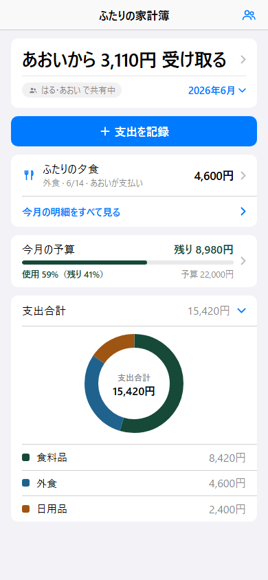
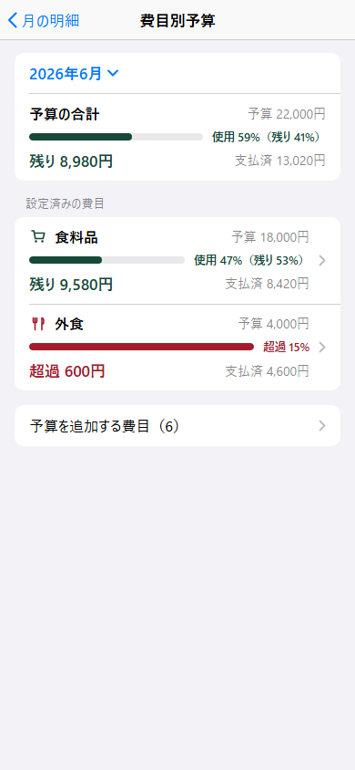
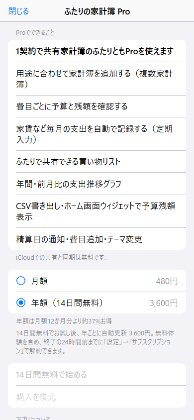

# ふたりの家計簿 第8回独立批評

**67 / 100（前回60点、+7）。現状では、立て替えを毎月精算する二人に無料版なら勧める。有料版を積極的に勧めるのは、招待相手の初回記録と予算の実用性を二人で確かめてから。** 日本の確定価格は月額480円・年額3,600円、共有家計簿は1契約で二人がProを使える。二人で使うと決める前に招待が止まりやすく、共同で予算を試す前に購入を求める点が、価格より大きい障壁と判断した。

## 7軸と総合点

各軸10点。総合は従来どおり7軸の平均を100点換算し、四捨五入。過去点は各回の原文。第8回は現行ソース、再生成したHTMLプレビュー、シェアルーの公開情報で評価した。視覚所見はすべて**推測（HTML近似）**。 [第5回](critic-r5.md) · [第6回](critic-r6.md) · [第7回](critic-r7.md)

再開時に確認した撮影一覧の先頭行は `失敗 37df6021db09542e6b6ff362877d7f976a45daec`。第8回の視覚所見は引き続きブラウザーのプレビューに基づく。 [撮影一覧](https://raw.githubusercontent.com/YutoNishimura-v2/futari-kakeibo/ci-shots/index.md)

| 軸 | r5 | r6 | r7 | r8 | 第8回の根拠 |
| --- | ---: | ---: | ---: | ---: | --- |
| 初回1分 | 6 | 7 | 7 | **7** | 家計簿が開けば記録・保存の2操作＋金額桁数。初回iCloud取込待ちと、空の家計簿で招待入口が出ない条件が残る。 |
| ホームの明快さ | 6 | 7 | 6 | **7** | 精算の向きと金額が一行で読め、記録ボタン、色付き予算残額、凡例付き支出グラフが見える（推測）。無料時の予算行はロック表示。 |
| メイン画面（予算・明細・精算） | 5 | 7 | 6 | **7** | 予算の使用バーと「使用」「残り」「超過」の意味が揃い、支払済も表示（推測）。集計対象、精算の根拠、過去月を探す手間は残る。 |
| 課金画面 | 6 | 6 | 5 | **7** | 二人で1契約、年額総額、対象者の体験、復元と規約が一画面に収まり、青い購入ボタンが目立つ（推測）。価値の実演と、最大文字サイズでの購入経路が弱い。 |
| 2〜7日目の継続理由 | 4 | 4 | 5 | **5** | 無料の精算ウィジェット、通知時刻の設定、記録後の招待入口はある。招待時のApple Accountメール入力と初回共同記録の摩擦が残る。 |
| ストア公開準備 | 6 | 6 | 6 | **6** | 掲載文・審査メモと価格は揃う。撮影一覧は404で、提出用画像の見出し、アイコン組込、配布設定、確定したサポート先の確認が残る。 |
| アクセシビリティ | 7 | 7 | 7 | **8** | 第7回修正後のソースでホームの共有情報・直近明細と予算行の拡大時縦積み、図に頼らず読める費目一覧を確認。購入プランは横並びで、Proの鍵に読み上げ用の状態説明がない。 |
| **総合 / 100** | **57** | **63** | **60** | **67** | **47 / 70**。直近3遷移は +6 → −3 → +7。 |

**停滞判定は「動いた」**。同点が3回続いたわけではなく、初回1分と2〜7日目は第7回から横ばい。次は招待先行の初回フローを試す。初回起動で「パートナーを招待」を主ボタン、「一人で先に記録」を副ボタンとする案を現行の記録先行と比較する。送付 → 承諾 → 相手の初回記録 → 二人が同じ明細を見るまでを測る。初回保存率も見て、招待先行が一人で始める利用者の離脱を増やしていないか判断する。

## 比較の根拠

シェアルーは日本のApp Storeで★4.5、Appleの検索APIで評価15,240件、無料＋アプリ内購入。掲載画像では大きな支出合計と費目グラフ、残り・超過の予算表示、人数別の割り勘、レシート入力、共有買い物リストを確認した。掲載文では入力の即時共有、予算残額、ワンクリック精算、ウィジェットを案内。掲載画像のホームは**支出合計**が主数値。精算額を最上段に置く、初回1分で誘う、月別精算履歴を見せる、という3点は依頼で提示された上位アプリの比較パターン。競合の初回実操作、購入画面、最大文字サイズは未計測。以下の「掲載①〜⑦」は末尾の画像番号。 [シェアルー App Store](https://apps.apple.com/jp/app/id1475406336) · [Apple 検索API](https://itunes.apple.com/jp/lookup?id=1475406336)

## ホームの改善点（見た目は推測）

| 対象と差 | 競合で確認したこと・比較パターン | 変更案 |
| --- | --- | --- |
| **空の家計簿ホーム**。「パートナーを招待」は支出1件以上が条件。同期中も新規記録へ進めない。 | 掲載①と掲載文は共有を最初の価値として提示。初回1分の招待は比較パターン。 | 空のホームにも招待と「一人で先に記録」を置く。iCloud待ちでは招待の前提と状態を示し、最初の支出を下書き保存して家計簿確定後に一度だけ登録できるようにする。 |
| **上段の精算額のタップ先**。矢印付きの「受け取る」を押すと月の明細が開く。 | 掲載③は割り勘の計算結果と人数別の内訳を同じ場面で示す。 | 精算額のタップで「今月の精算」を直接開き、誰から誰へいくらかと各人の支払・負担を見せる。「今月の明細」は既存のリンクから開く。 |
| **「ふたりの夕食」の1件枠**。相手の記録があればそちらを優先するため、自分の保存直後に別の明細が残りうる。 | 掲載文では誰が入力してもすぐ共有される。 | 保存直後はその明細を「今の記録」として表示し、保存済みと共有の反映待ちを明示。次回起動からは二人の最新順に戻し、支払者名を残す。 |
| **「今月の予算」**。プレビューは残り8,980円まで示すが、無料の実装では「費目別予算」のロックが出る。 | 掲載②と掲載文で残額や超過が毎日見る答えになっている。 | 無料で共有の月合計予算を1つ設定し、ホームで残額を確認できるようにする。費目別予算と前月引継ぎが必要なときにProを案内する。 |
| **「支出合計」**。展開時は行と円の中央で15,420円を反復。凡例から明細への遷移がない。 | 掲載①は円中央に支出合計を置き、費目を区別する。 | 展開時は合計を円中央に1回表示し、費目名・金額の凡例を押すと当月の費目明細を開く。拡大文字や読み上げでは見出しと一覧に合計を残す。 |
| **「2026年6月」メニューと「先月の精算を確認」**。任意の過去月は前月・次月で送る。 | 月別精算履歴は比較パターン。掲載文では月末の確認と精算を訴求。 | 月メニューに「精算履歴」を追加し、月・済／未済・記録日を並べる。過去の支払額を示す場合は精算時に保存した確定額を使い、既存月で額が未保存なら日付のみ表示する。 |

根拠は `FirstExpensePrompt`、`recentExpense`、`settlementHeader`、`HomeSpending` と初回取込条件。 [ホーム実装](../Sources/FutariKakeibo/FutariKakeiboApp.swift) · [同期実装](../Sources/FutariKakeibo/CloudLedger.swift)

## メイン画面・費目別予算の改善点（見た目は推測）

| 対象と差 | 競合で確認したこと・比較パターン | 変更案 |
| --- | --- | --- |
| **「予算の合計」「支払済13,020円」**。ホームの支出15,420円との差2,400円は、予算未設定の日用品。集計範囲が見出しから読めない。 | 掲載②は合計と費目別の支払済・超過を併記。 | 合計カードを「設定済み費目の予算」に変更。直下の明細リンクに「予算未設定の支出 2,400円」を出す。予算未設定分を含むかは読み上げにも含める。 |
| **「設定済みの費目」**。例では残額の食料品の後に、超過している外食が並ぶ。 | 掲載②は外食などの個別費目の超過状態を色で強調し、最初の閲覧で気づかせる。 | 超過行を先頭にまとめ、同じ状態内では既存の費目順を保つ。「超過」の文言と色を併用し、返金で残額に戻った行も更新する。 |
| **外食の赤バーと「超過15%」**。バーは100%で止まり、大幅超過と小幅超過が同じ長さになる。 | 掲載②は超過額を色と実額で表す。 | 100%の予算線を付け、超過分は線の先に別パターンで示す。上限を超える幅は固定し、超過額・割合の文字と読み上げで実数を伝える。 |
| **「予算を追加する費目（6）」**。未設定で支出済みの費目が折りたたみ内にあり、展開後も「未設定」だけ。 | 掲載②は費目と実際の支出を結びつけて判断させる。 | 既に支出がある未設定費目を上に出し、「日用品・支払済2,400円 → 予算を設定」と表示。支出ゼロの費目は既存の折りたたみに置く。 |
| **食料品・外食行の矢印**。超過理由を確認したい時も行の遷移先は予算額の編集。 | 掲載①・②は費目ごとの可視化で使いすぎの原因を辿る手がかりを出す。 | 行を開いた先に同じ月の費目明細と「予算額を編集」を置く。編集後は同じ費目・同じ月に戻す。 |
| **隣接する「月の精算」**。結果と端数説明、締め操作はあるが、二人それぞれの支払額と負担額を表示しない。ソースで確認。 | 掲載③は人別に割り勘内訳を示す。 | 「計算を見る」に二人の支払額・負担額・差引を追加し、返金と固定額を含む既存計算の値をそのまま表示する。 |

根拠は `BudgetSettings`、`BudgetProgressRow`、`SettlementReview`。 [予算実装](../Sources/FutariKakeibo/ProSettings.swift) · [精算実装](../Sources/FutariKakeibo/FutariKakeiboApp.swift)

## 課金画面の改善点（見た目は推測）

| 対象と差 | 競合で確認したこと・比較パターン | 変更案 |
| --- | --- | --- |
| **「Proでできること」直下の4行**。機能を二つずつ束ね、何が二人に効くかを想像する負担が大きい。 | 掲載②・③・⑤は残額、割り勘、共有買い物と、結果を一場面ずつ見せる。 | 入口に合わせて主説明を1つ選ぶ。予算から開いた場合は「二人の支出が入ると食費の残りが更新される」短い数値例を示し、全機能は「ほかのPro機能」で開く。 |
| **「1契約で共有家計簿のふたりともProを使えます」**。無料との違いを説明するのは直下の同期1行だけ。 | 掲載文は基本無料を明示し、無料で始める目的を示す。 | 「無料で記録・共有・精算」「Proで費目別予算・定期入力」の2行にする。閉じて戻れば共有を続けられることを、課金入口の文言にも反映する。 |
| **年額行の「実質 月300円（1人あたり月150円）」と下部の更新条件**。年額総額、月換算、割引率、無料体験の条件が別々に出る。 | 掲載③は人数と負担の関係を隣で示す。価格の見せ方は公開画像から未確認。 | 年額カードで請求総額3,600円を主表示にし、月換算は補足にする。ボタンのすぐ近くに「対象者は14日間無料、その後3,600円／年で自動更新」を表示。対象外・価格未取得では状態に応じて出し分ける。 |
| **年額行の選択印・プラン名・「おすすめ」・価格**。横並びが重なりやすい構造。 | 掲載⑤は共有リストの項目を縦に分け、視線の順番が明確。競合の文字拡大実装は未確認。 | 最大文字サイズでプラン名、請求額、体験条件を縦に積み、ラジオの選択状態と金額、更新条件をひと続きで読ませる。CTA、復元、規約までスクロール可能にする。 |
| **「14日間無料で始める」**。HTMLでは活性状態のみ。SwiftUIでは価格未取得・家計簿の準備中・処理中で押せない条件があり、理由が購入操作から離れる。 | 掲載文は「ワンクリック精算」など主操作と結果を明示。競合の購入待機表示は未確認。 | ボタン直近に理由を出し、取得失敗ならそこで「価格を再読み込み」、同期待ちなら「家計簿の準備ができると開始できます」を示す。復元は購入処理中以外は使える現行仕様を保つ。 |
| **ホームの鍵付き「費目別予算」から開く購入画面**。購入前に二人の利用例を操作できない。 | 掲載②は費目名と実額で予算の体験を先に伝える。 | 鍵の行を「費目別予算・Pro」と読み上げ、入口で使い方の見本を開く。設定前の家計簿でも見本の残額・超過を確認してから購入条件に進めるようにする。 |

根拠は `optionRow`、`purchaseTerms`、`loadProducts` と `ProLock`。 [購入画面実装](../Sources/FutariKakeibo/ProPaywall.swift) · [Proの入口](../Sources/FutariKakeibo/ProSettings.swift)

## 優先順位 上位8件

順位はインストールから初回有料請求までと、2〜7日目の再利用への影響を合わせた推定。高・中・低は相対評価。無料体験の開始と初回請求は別に集計し、再利用は開いただけの起動と区別して本人または相手の記録・明細確認・予算確認を測る。

| 順位 | 変更 | インストール→初回有料請求 | 2〜7日目の継続 | 比較時に見る先行指標 |
| ---: | --- | --- | --- | --- |
| 1 | **招待先行の初回フロー**。空の家計簿から招待と自分の入力に進める。相手のApple Accountメールを入力する理由を欄の直前に置く。 | 高。二人とも使い始めると1契約の価値を判断できる。 | 高。相手の最初の記録が次に開く理由になる。 | 起動60秒以内の招待開始、24時間以内の承諾・相手保存、初回保存率 |
| 2 | **iCloud初回待ちでも支出を下書き**。同期先が確定したら重複なしで登録する。 | 高。商品を見る以前の初回離脱を減らす。 | 高。初日から残高の計算に使える。 | 60秒以内の入力開始、24時間以内の保存、同期失敗・二重登録率 |
| 3 | **基本の月予算を無料に**。残額をホームに出し、費目別予算と前月引継ぎをProに置く。 | 中〜高。価値を知ってから費目別へ進める。現行ロック起点の売上低下も測る。 | 高。月末以外にも確認する数字ができる。 | 無料予算作成率、残額の再閲覧、費目別への体験開始と初回請求 |
| 4 | **購入入口別の使用例と、ボタン横の請求条件**。価格エラーの回復も近くに置く。 | 高。購入する機能と実際の請求が明確になる。 | 中。体験中に目的の機能を使いやすい。 | 購入画面→体験→初回請求、価格再取得成功、体験中の機能使用 |
| 5 | **二人の初回記録をホームで確認**。直後の保存結果を明示し、次回は本人・相手の最新記録を表示する。 | 中。同期を信頼して同じ家計簿を使い続けやすい。 | 高。相手の入力を見て自分も記録する循環ができる。 | 二人目の初回保存→相手の明細確認、7日以内に両者が2回以上記録 |
| 6 | **精算額から人別内訳と月別履歴へ**。締め済みの月は確定時点の情報を表示する。 | 中。別財布の二人にお金を任せる理由ができる。 | 中。立て替えの確認と月をまたぐときの行き先ができる。 | 精算内訳到達率・再閲覧、締めから解除までの回数 |
| 7 | **費目別予算の集計範囲と超過理由**。未設定の支出も示し、超過行から明細へ進める。 | 中。費目別予算を買う具体的な価値が伝わる。 | 中。使いすぎに気づいた後の確認が早い。 | 超過行→費目明細、未設定費目の予算登録、予算の再閲覧 |
| 8 | **文字拡大・読み上げで購入と予算確認を完走**。プランを縦積みし、ロック状態・選択状態を言葉で伝える。 | 中。拡大文字・読み上げ利用者の申込みの障壁を下げる。 | 中。同じ条件で普段の確認を続けられる。 | 最大Dynamic TypeとVoiceOverで、招待・記録・予算超過確認・プラン選択・復元を完走した割合 |

ストアの提出準備では、別Apple Account間の招待・同期と購入の復元を署名済みビルドで検証し、掲載1枚目から「二人の精算 → 予算残額 → すぐ記録」を同じデモ家計簿で見せる。現行の提出チェックリストにはサポートURLが未確定と記載され、リポジトリの設定に配布用識別子の登録手順が残っている。 [提出チェックリスト](release-checklist-detail.md) · [プロジェクト設定](../project.yml)

## 画像と確認記録

指定の撮影一覧は取得時に **HTTP 404**。比較の主画像は `node tools/preview/render.mjs` で再生成した**ローカルHTML近似PNG**で、競合側はApp Storeの**掲載画像**。レンダラーはローカルHTMLを使い、GPUとバックグラウンド通信を無効にして実行した。終了コード0、ログは `tmp/render-r8.log`。批評者が下記の**自アプリ3枚・競合7枚をすべて個別に開いて確認**した。PNGの寸法とSHA-256は画像検査、バイト数はファイル情報で照合した。最大文字サイズの実機レイアウト、VoiceOverの実際の読み順、ライブの招待・購入は未検証。 [指定の撮影一覧](https://raw.githubusercontent.com/YutoNishimura-v2/futari-kakeibo/ci-shots/index.md)

| 自アプリ画像 | 寸法 | サイズ | SHA-256 |
| --- | --- | ---: | --- |
| `docs/preview/home-390.png` | 390×844 | 47,965 B | `58b6b957e38f09027643c0cb34d9787071dd5f1bbc04ba653bab880f69e9b74f` |
| `docs/preview/budget-390.png` | 390×844 | 38,249 B | `3f37a1ff5cdda34966ca06ed1b0996a14fdfb446f6504821f9460d588dadbd6f` |
| `docs/preview/paywall-390.png` | 390×844 | 72,758 B | `fc671095e901c62736ed1a43e46879280f2d67a8180b5e2ea83e1435099b580d` |

| シェアルー掲載画像（作業領域外の閲覧用ダウンロード） | サイズ | SHA-256 | 取得先 |
| --- | ---: | --- | --- |
| 1. 共有家計簿・支出グラフ | 20,180 B | `8271b0c45c28b67c0897b2283d12b62d1da906e79fe4657482ce048fd86cbc2b` | [掲載画像](https://is1-ssl.mzstatic.com/image/thumb/PurpleSource211/v4/57/ac/74/57ac7487-6efa-83a3-c7a7-118e4453ffa5/ScreenShot_iPhone6.7_v18_resize.001.png/320x480bb.jpg) |
| 2. 費目別予算 | 14,685 B | `ff76f1de1ecbc9f3852f1500540a61629c6879e2d492a75a4d1b6352c2286bad` | [掲載画像](https://is1-ssl.mzstatic.com/image/thumb/PurpleSource221/v4/1f/e9/f4/1fe9f4b2-617c-13d2-ff67-05cc7fe7892b/ScreenShot_iPhone6.7_v18_resize.002.png/320x480bb.jpg) |
| 3. 人数別の割り勘 | 12,937 B | `4563a0107a5df6ee2821dbd41711c9a74769ad0f23c937aa2a42692bec0d258e` | [掲載画像](https://is1-ssl.mzstatic.com/image/thumb/PurpleSource221/v4/c8/39/d2/c839d204-4829-a5cf-fae4-3e4d9f91f015/ScreenShot_iPhone6.7_v18_resize.003.png/320x480bb.jpg) |
| 4. レシート入力 | 13,782 B | `939342708277536fdae94d7707973cbcce484abacc94adedd1610928c3d3b2da` | [掲載画像](https://is1-ssl.mzstatic.com/image/thumb/PurpleSource211/v4/80/26/36/802636b1-aea9-4843-20f2-b64384523e60/ScreenShot_iPhone6.7_v18_resize.004.png/320x480bb.jpg) |
| 5. 共有買い物リスト | 10,550 B | `918de5c4cd6e574f06c989d4ccbd3bc62b64d1e8bf479b5c7134f8ec092521f7` | [掲載画像](https://is1-ssl.mzstatic.com/image/thumb/PurpleSource221/v4/c2/c6/0e/c2c60e82-21b8-5361-1e7b-9b5a34675a50/ScreenShot_iPhone6.7_v18_resize.005.png/320x480bb.jpg) |
| 6. 共有ToDo | 10,910 B | `82bf73555feaef0ef0d4edf70ee15dbbb11ac1b6ef79d700c6ba51c58eb2025c` | [掲載画像](https://is1-ssl.mzstatic.com/image/thumb/PurpleSource211/v4/a9/6a/ff/a96aff94-35f2-8502-c6a2-32509264b160/ScreenShot_iPhone6.7_v18_resize.006.png/320x480bb.jpg) |
| 7. 家計簿のテーマ | 15,378 B | `1ccac1fc07776f32188fe4bd7ebcebdff12c83b20680b04d3bac1888d3db58a2` | [掲載画像](https://is1-ssl.mzstatic.com/image/thumb/PurpleSource211/v4/a6/c9/46/a6c94670-d2df-2126-939a-b10bf57a918b/ScreenShot_iPhone6.7_v18_resize.007.png/320x480bb.jpg) |
