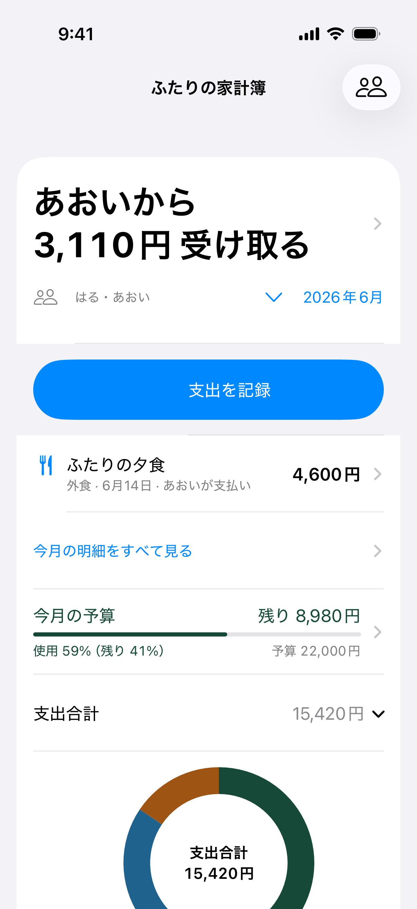
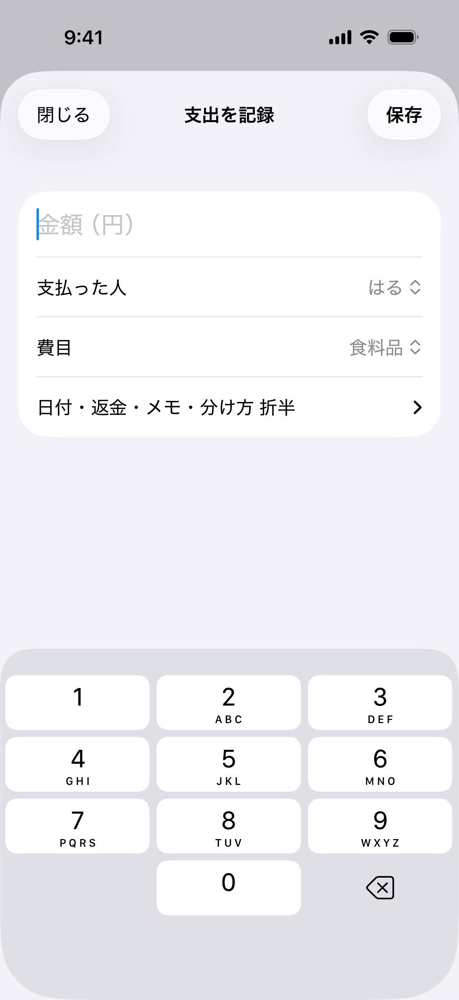
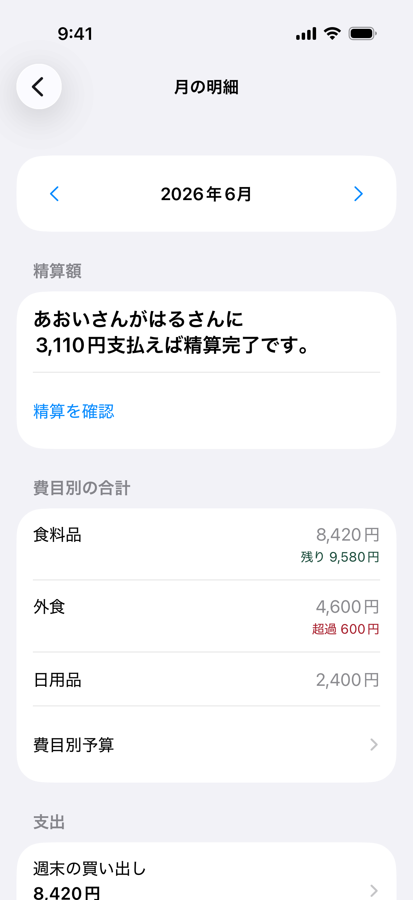
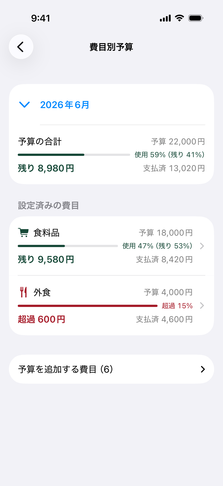
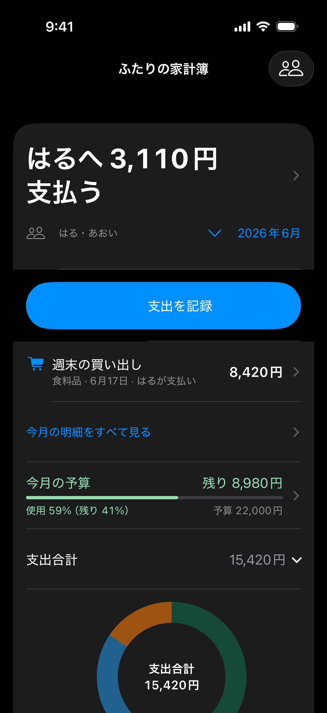
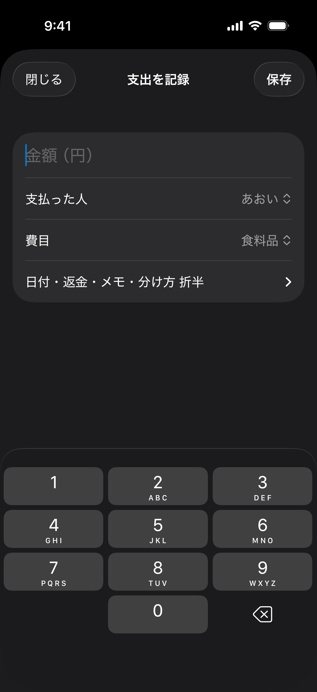
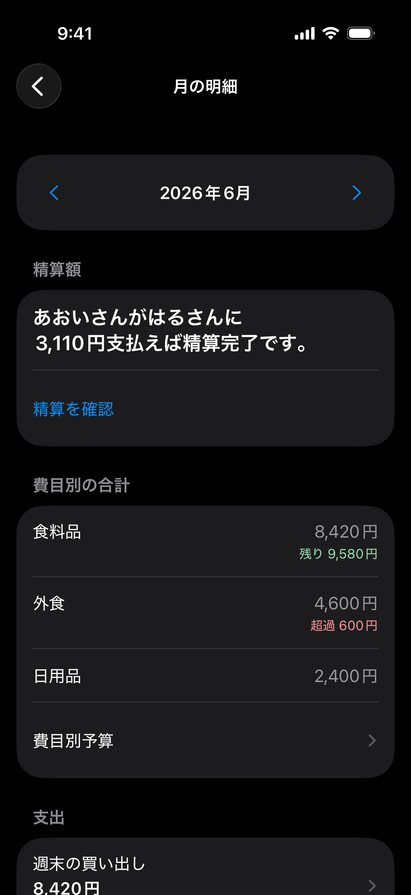
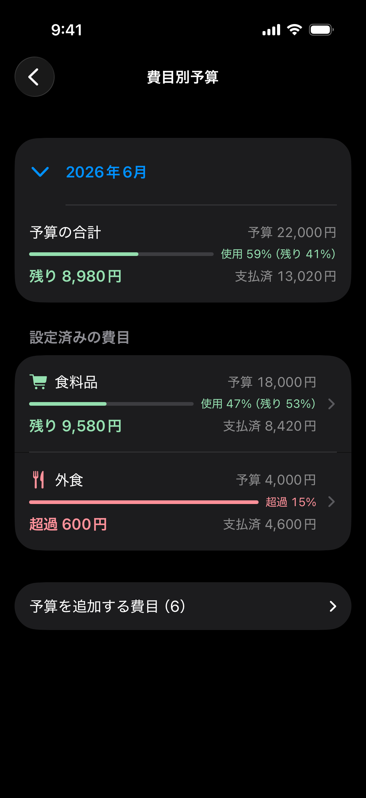

成功 e3aa3ab39afe0770d3641800dbc639ccd97a28d1

実行: https://github.com/YutoNishimura-v2/futari-kakeibo/actions/runs/46129518281

# ふたりの家計簿

## ライト

### ホーム

### 支出入力

### 月の明細

### 月の精算

### 費目別予算

### 購入画面

## ダーク

### ホーム

### 支出入力

### 月の明細

### 月の精算

### 費目別予算

### 購入画面

